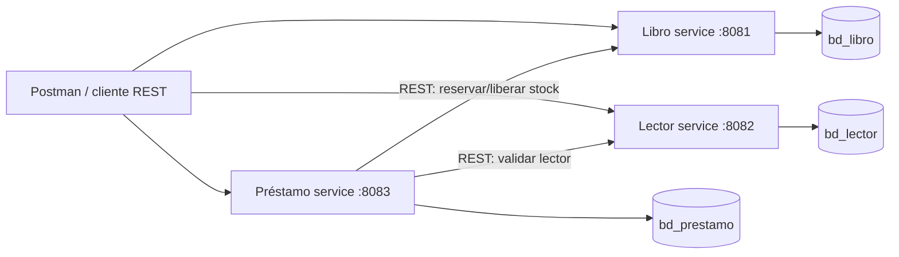

# Biblioteca Eva 03: microservicios

Implementación de servicios REST independientes para libros, lectores y préstamos. Cada servicio es un módulo Maven ejecutable, usa su propia base MySQL y expone DTOs validados; los errores devuelven JSON con `timestamp`, `status`, `error`, `message` y `path`.

## Arquitectura



Préstamo guarda los identificadores, no claves foráneas entre bases. Al registrar un préstamo valida que exista el lector, reserva una unidad disponible y guarda la operación. Al devolver, libera una unidad y cambia el estado a `DEVUELTO`. La comunicación es síncrona HTTP; no hay una transacción distribuida entre bases de datos.

## Requisitos y ejecución

- Java 17 o superior y Maven 3.9 o superior.
- MySQL 8.4. Se puede levantar en local con Docker Compose:

```powershell
Copy-Item .env.example .env
docker compose up -d mysql
```

El script `database/schema.sql` crea `bd_libro`, `bd_lector` y `bd_prestamo` con sus tablas. En el perfil `dev`, Hibernate actualiza el esquema automáticamente; para `prod`, primero se debe crear el esquema (por ejemplo, aplicando el script) y Hibernate valida las tablas.
Esperar a que `docker compose ps` muestre MySQL como `healthy` antes de iniciar los servicios. El archivo `.env` lo lee Docker Compose; si se cambian credenciales, también hay que establecer `DB_USER` y `DB_PASSWORD` en la terminal donde se inicia cada servicio. En PowerShell:

```powershell
$env:DB_USER = "root"
$env:DB_PASSWORD = "biblioteca_dev"
```

Ejecutar cada comando en una terminal distinta, desde la raíz:

```powershell
mvn -pl libro-service spring-boot:run
mvn -pl lector-service spring-boot:run
mvn -pl prestamo-service spring-boot:run
```

También se puede compilar todo el reactor con `mvn clean verify`. Puertos por defecto: libro `8081`, lector `8082`, préstamo `8083`.

## Perfiles y configuración

Los YAML comunes (`application.yml`) definen el puerto, nombre del servicio y valores compartidos. `application-dev.yml` y `application-prod.yml` definen conexión MySQL y comportamiento de Hibernate:

| Variable / valor | Desarrollo (`dev`) | Producción (`prod`) |
|---|---|---|
| Perfil | `dev` es el perfil predeterminado | Iniciar con `SPRING_PROFILES_ACTIVE=prod` |
| Base de datos | `localhost:3306/bd_libro`, `bd_lector` o `bd_prestamo` | `DB_URL` obligatorio, distinto para cada servicio |
| Credenciales | `DB_USER=root`, `DB_PASSWORD=biblioteca_dev` por defecto | `DB_USER` y `DB_PASSWORD` obligatorios; usar secretos |
| Esquema | `ddl-auto=update`; SQL visible | `ddl-auto=validate`; SQL oculto |
| Puertos | `SERVER_PORT` o 8081/8082/8083 | `SERVER_PORT` según despliegue |
| URLs entre servicios | localhost:8081 y localhost:8082 | `LIBRO_SERVICE_URL` y `LECTOR_SERVICE_URL` del entorno |

Cada servicio lee las variables `DB_URL`, `DB_USER` y `DB_PASSWORD` de forma independiente, por lo que su configuración debe apuntar a su propia base. `.env.example` contiene valores únicamente para el entorno local; no usar esas credenciales en producción.

## API REST

Todas las peticiones y respuestas usan JSON. `POST` devuelve `201`, `DELETE` devuelve `204`, las validaciones/formato inválido `400`, los recursos inexistentes `404`, conflictos (ISBN/documento duplicado, stock agotado o devolución repetida) `409`, y una indisponibilidad de servicios dependientes de préstamo `502`.

| Servicio | Operaciones |
|---|---|
| Libro | `GET /api/libros`, `GET /api/libros/{id}`, `POST /api/libros`, `PUT /api/libros/{id}`, `DELETE /api/libros/{id}` |
| Lector | `GET /api/lectores`, `GET /api/lectores/{id}`, `POST /api/lectores`, `PUT /api/lectores/{id}`, `DELETE /api/lectores/{id}` |
| Préstamo | `GET /api/prestamos`, `GET /api/prestamos/{id}`, `POST /api/prestamos`, `POST /api/prestamos/{id}/devolucion` |

Libro expone además `POST /api/libros/{id}/reservas` y `POST /api/libros/{id}/liberaciones`, usados por préstamo para mantener stock. Estado de libro (`DISPONIBLE`/`AGOTADO`) deriva del stock; el estado del préstamo cambia de `PRESTADO` a `DEVUELTO`.

Ejemplo de libro:

```json
{"isbn":"978-0-306-40615-7","titulo":"Ejemplo de libro","autor":"Ana Autora","stock":3}
```

Ejemplo de lector:

```json
{"documento":"12345678","nombres":"María Pérez","contacto":"maria@example.com"}
```

Ejemplo de préstamo:

```json
{"lectorId":1,"libroId":1,"fechaPrestamo":"2026-11-06","fechaLimite":"2026-11-20"}
```

La fecha límite debe ser igual o posterior a la fecha del préstamo. Los identificadores deben ser positivos y el lector/libro deben existir. Un stock cero no permite iniciar un préstamo.

Respuesta esperada del registro correcto (`201`, IDs asignados al crear datos previamente):

```json
{"id":1,"lectorId":1,"libroId":1,"fechaPrestamo":"2026-11-06","fechaLimite":"2026-11-20","estado":"PRESTADO"}
```

Ejemplo de error de validación (`400`):

```json
{"timestamp":"2026-11-06T18:30:00Z","status":400,"error":"Bad Request","message":"la fecha límite debe ser igual o posterior a la fecha de préstamo","path":"/api/prestamos"}
```

## Postman y evidencias

Importar `postman/Biblioteca.postman_collection.json`. Ejecutar en orden: crear lector, crear libro (la colección genera documentos/ISBN nuevos y captura IDs), crear préstamo (captura el ID), devolver préstamo. La colección incluye también préstamo con libro inexistente, fechas inválidas y devolución repetida para observar y comprobar `404`, `400` y `409`. Ejecutar con los tres servicios activos y MySQL disponible.

La colección es evidencia reproducible para los casos exitosos y fallidos. Para entregar capturas, guardar desde Postman la respuesta `201` del préstamo y la respuesta de error `404` o `400`.

## Conclusiones

1. La separación permite que cada dominio evolucione y escale sin desplegar los demás servicios.
2. Cada servicio es dueño de sus tablas y base; los otros servicios acceden a sus datos mediante API y no mediante consultas cruzadas.
3. Las validaciones en DTO y las restricciones de base reducen datos inválidos y duplicados.
4. El préstamo coordina disponibilidad y devolución mediante llamadas REST, pero no ofrece atomicidad distribuida; fallos entre servicios requieren monitoreo y una estrategia de compensación más robusta para producción.
5. Las respuestas HTTP diferenciadas facilitan que Postman y los clientes distingan validación, ausencia de recursos, conflictos y fallos de dependencias.

## Guion para sustentación individual

**¿Por qué separar el sistema?** Libros, lectores y préstamos son dominios distintos y tienen ciclos de cambio/despliegue propios. Así se reduce el acoplamiento, aunque se añade la complejidad de coordinar llamadas entre servicios.

**¿Cómo persiste los datos?** Cada servicio usa Spring Data JPA y MySQL con una base exclusiva (`bd_libro`, `bd_lector`, `bd_prestamo`). Préstamo conserva IDs y valida las referencias llamando las APIs de libro y lector.

**¿Qué pasa con información inválida?** Bean Validation rechaza el DTO antes de ejecutar la lógica y devuelve `400` con un mensaje; un ID inexistente devuelve `404`, y conflictos como stock agotado devuelven `409`. La base también protege los campos únicos.
